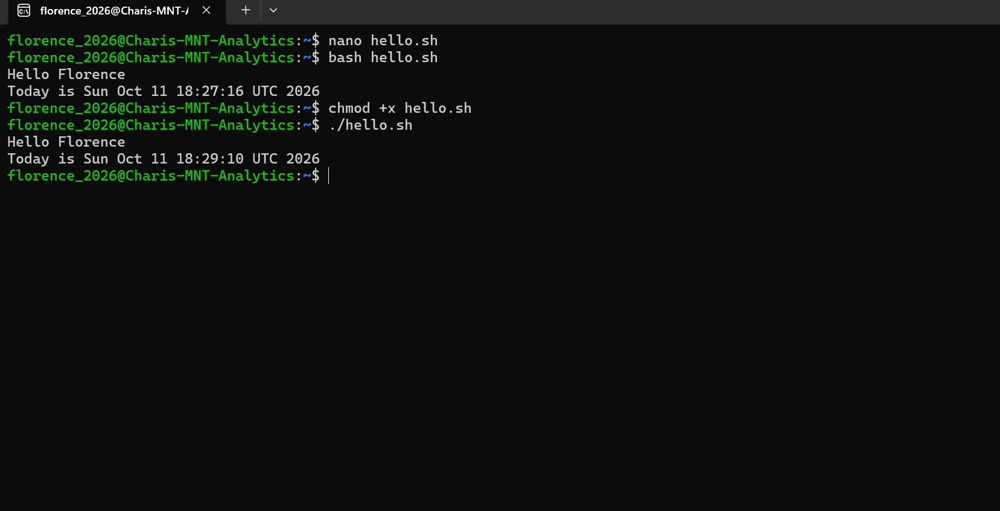
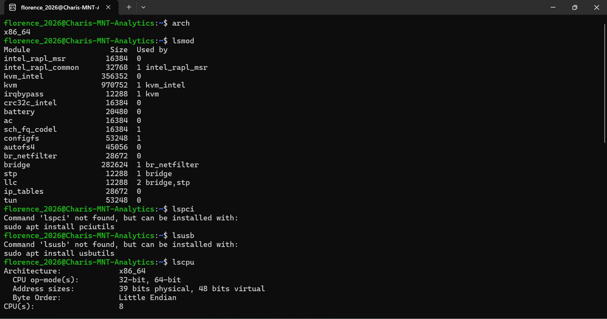
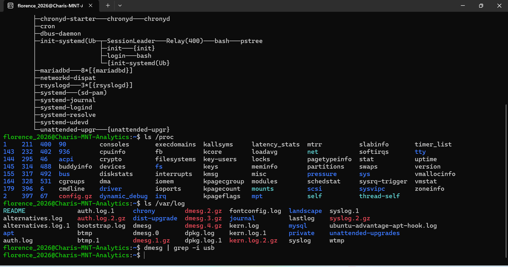
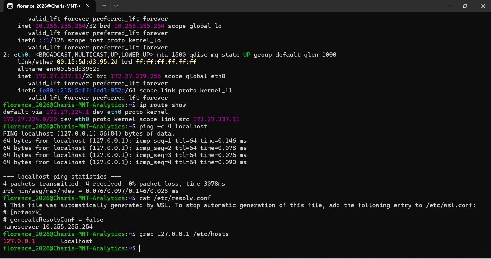

# Linux Essentials Week 4 Documentation

## Modules 11–14: Basic Scripting, Computer Hardware, System Data and Network Configuration

This week, I continued my Linux Essentials journey by learning about basic shell scripting, computer hardware, Linux processes and system information, and network configuration.

The practical exercises helped me move beyond simply reading about Linux. I created and executed a Bash script, examined hardware and kernel information, explored process and log data, and used networking commands to inspect how my Linux environment communicates.

## What I Learnt

### Module 11 – Basic Scripting

I learnt that shell scripts allow several Linux commands to be placed inside a text file and executed together.

I created a simple script called:

```bash
hello.sh
```

The script contained:

```bash
#!/bin/bash
NAME="Florence"
echo "Hello $NAME"
echo "Today is $(date)"
```

The first line:

```bash
#!/bin/bash
```

is called the shebang. It tells Linux to use the Bash shell to execute the script.

I also learnt how variables work. In my script:

```bash
NAME="Florence"
```

stores the value `Florence`, while:

```bash
$NAME
```

retrieves that value.

I first executed the script using:

```bash
bash hello.sh
```

I then made the script executable using:

```bash
chmod +x hello.sh
```

and ran it directly using:

```bash
./hello.sh
```

Both methods produced the expected output.

## Screenshot 1 – Basic Shell Scripting



This exercise helped me understand how Bash scripts can be created, executed and given executable permissions.

---

## Module 12 – Computer Hardware

I learnt that Linux provides commands for examining hardware and system architecture directly from the terminal.

### `arch`

```bash
arch
```

This command displayed:

```text
x86_64
```

This showed me that my Linux environment is using a 64-bit x86 architecture.

### `lsmod`

```bash
lsmod
```

The `lsmod` command displays kernel modules currently loaded into the Linux kernel.

The output showed modules such as:

```text
kvm_intel
kvm
bridge
ip_tables
```

### `lscpu`

```bash
lscpu
```

The `lscpu` command displays detailed CPU information.

From my output, I could see information such as:

```text
Architecture: x86_64
CPU op-mode(s): 32-bit, 64-bit
CPU(s): 8
```

This helped me understand how Linux provides detailed hardware information without needing a graphical system-information tool.

## Commands That Were Not Available

I also tried:

```bash
lspci
```

and:

```bash
lsusb
```

Both commands returned messages showing that the required packages were not installed.

For example, Linux suggested installing:

```bash
sudo apt install pciutils
```

for `lspci`, and:

```bash
sudo apt install usbutils
```

for `lsusb`.

This was an important learning point because not every Linux command is installed by default.

## Screenshot 2 – Hardware Information



This screenshot shows my practice with architecture, kernel modules and CPU information.

---

## Module 13 – Where Data Is Stored and Process Monitoring

I learnt that Linux provides several ways to inspect running processes and system information.

### `pstree`

```bash
pstree
```

The `pstree` command displays running processes in a tree structure.

This helped me understand the relationship between parent and child processes.

### `/proc`

I explored the `/proc` virtual filesystem using:

```bash
ls /proc
```

The output contained information related to processes and the Linux kernel.

I could see entries such as:

```text
cpuinfo
meminfo
modules
loadavg
uptime
version
```

as well as directories represented by process IDs.

### `/var/log`

I also explored the Linux log directory:

```bash
ls /var/log
```

The output included files and folders such as:

```text
auth.log
syslog
kern.log
dmesg
journal
wtmp
```

I learnt that Linux log files provide useful information for troubleshooting, security monitoring and system administration.

### `dmesg`

I used:

```bash
dmesg | grep -i usb
```

This command combines `dmesg` and `grep`.

`dmesg` displays kernel messages, while:

```bash
grep -i usb
```

filters the results for USB-related information while ignoring uppercase and lowercase differences.

In my environment, the command returned no visible USB-related results at that moment.

## Screenshot 3 – Process and System Monitoring



This exercise helped me understand where Linux stores system information and how administrators inspect processes, kernel information and logs.

---

## Module 14 – Network Configuration

This module introduced me to Linux networking concepts and commands.

I learnt about:

- IP addresses
- Network interfaces
- Routing
- Localhost
- DNS
- Network configuration files

### `ip addr`

I used the `ip` command to inspect my network interfaces.

The output showed the `eth0` interface and its IP configuration.

My environment displayed an IPv4 address similar to:

```text
172.27.237.11/20
```

It also showed the loopback interface with:

```text
127.0.0.1
```

I learnt that `127.0.0.1` represents the local computer.

### `ip route show`

```bash
ip route show
```

This command displayed the system routing table.

The output showed a default route through:

```text
172.27.224.1
```

This helped me understand how Linux determines where network traffic should be sent.

### `ping`

I tested the local system using:

```bash
ping -c 4 localhost
```

The command sent four packets to:

```text
127.0.0.1
```

and all four were successfully received.

The result showed:

```text
4 packets transmitted, 4 received, 0% packet loss
```

This confirmed that the localhost network interface was responding correctly.

### `/etc/resolv.conf`

I viewed DNS configuration using:

```bash
cat /etc/resolv.conf
```

The file showed a configured nameserver.

My Linux environment also indicated that the file had been automatically generated by WSL.

This helped me understand that DNS configuration may differ depending on the Linux environment being used.

### `/etc/hosts`

I checked the localhost entry using:

```bash
grep 127.0.0.1 /etc/hosts
```

The output showed:

```text
127.0.0.1 localhost
```

This demonstrated how the `/etc/hosts` file maps a hostname to an IP address.

## Screenshot 4 – Network Commands



This exercise helped me understand how Linux displays IP addresses, routing information, DNS configuration and local hostname mappings.

---

# Commands I Practised

| Command | What I Learnt |
|---|---|
| `nano hello.sh` | Opens or creates a text file using Nano |
| `bash hello.sh` | Runs a Bash script |
| `chmod +x hello.sh` | Makes a script executable |
| `./hello.sh` | Runs an executable script |
| `arch` | Displays system architecture |
| `lsmod` | Displays loaded kernel modules |
| `lscpu` | Displays CPU information |
| `lspci` | Displays PCI devices when the required package is installed |
| `lsusb` | Displays USB devices when the required package is installed |
| `pstree` | Displays processes in a tree structure |
| `ls /proc` | Displays process and kernel information |
| `ls /var/log` | Displays system log files |
| `dmesg` | Displays kernel messages |
| `grep` | Filters text based on a pattern |
| `ip addr` | Displays network interfaces and IP addresses |
| `ip route show` | Displays routing information |
| `ping -c 4 localhost` | Tests local network connectivity |
| `cat /etc/resolv.conf` | Displays DNS resolver configuration |
| `grep 127.0.0.1 /etc/hosts` | Finds the localhost mapping |

---

# Challenges I Experienced

One challenge this week was learning that some commands are not installed by default.

When I tried `lspci` and `lsusb`, Linux informed me that the commands were unavailable and suggested the packages required to install them.

Instead of seeing this as a failure, I learnt that Linux environments can have different packages installed depending on their purpose.

Another challenge was interpreting the large amount of information produced by commands such as `lsmod`, `lscpu`, `/proc`, and networking commands.

At first, the output looked complicated, but breaking it into smaller parts helped me understand what each command was showing.

I also learnt that my Linux environment is running through WSL, which affects some networking and hardware information compared with a traditional Linux installation.

---

# Key Takeaways

My biggest takeaway from this week's learning is that Linux gives users direct visibility into almost every part of the system.

I can now:

- Create and execute simple Bash scripts
- Use variables inside scripts
- Change file permissions
- Inspect CPU architecture
- View loaded kernel modules
- Examine running processes
- Explore `/proc`
- Inspect system logs
- View network interfaces
- Examine routing information
- Test localhost connectivity
- Inspect DNS and hostname configuration

The most important lesson for me is that learning Linux is not about memorising every command.

It is about understanding what the commands do, practising them, interpreting the output and learning from errors when they occur.

Each practical session is helping me become more confident working directly from the Linux terminal.
